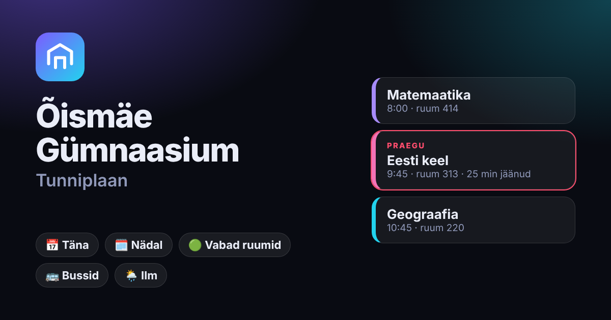

# Õismäe Gümnaasium · Tunniplaan

**→ https://viki-ee.github.io/tunniplaan/**

A faster, friendlier way to read the [Õismäe Gümnaasium EduPage timetable](https://oismae.edupage.org/timetable/), on your phone or computer. Not an official school site.

## What it does
- **Today**: what's on now, how many minutes are left, what's next. Back-to-back lessons are merged, and parallel group lessons sit side by side.
- **Week**: a grid on a computer, a day-by-day list on a phone. Prints on one A4 page.
- **Live**: every class, teacher or room right now (or at any period). Find free rooms.
- **Teachers**: who's at school today, who's teaching right now, who has a day off.
- **Events**: tests, homework, trips. School breaks and public holidays are built in. Share an event with classmates as a link.
- **Bus**: routes from your address to the first lesson and back, plus live departures from Kullerkupu, Meelespea and Rukkilille (via peatus.ee).
- **Weather** for the trip to school and back, with what-to-wear tips.
- **Meet**: compare classes and teachers to find common free time.
- Groups filter ("my groups"), notes per subject, a pack-your-bag checklist, a focus mode with a big clock, the bell schedule and a calendar (.ics) export.
- **Calendar subscription**: Google Calendar, iPhone or Outlook keep your class's or teacher's timetable up to date (breaks and holidays left out).
- **Timetable changes**: if EduPage's timetable changes, a ⚠️ pill shows exactly what moved.
- Estonian, English, Russian and Ukrainian. Dark, black (OLED), light or auto theme, adjustable size. Installable as an app, and it still opens offline.

## Android app
Download **tunniplaan.apk** from [Releases](https://github.com/viki-EE/tunniplaan/releases/latest) on your phone, open it and allow installing from your browser if Android asks. The app shows the same site, and adds a **home-screen widget** (current and next lesson) and **notifications 5 minutes before each lesson** (Settings → Lesson reminders). GitHub Actions builds it from `android/` (`.github/workflows/android.yml`).
The signing key (`android/release.jks`) is public on purpose, so only install the APK from this repo's Releases page.

**iPhone:** open the site in Safari → Share → *Add to Home Screen*.

## How it works
GitHub Actions (`.github/workflows/pages.yml`) runs `scripts/build-static.js` three times a day. The script downloads the public timetable from EduPage and publishes `public/` plus `data/*.json` to GitHub Pages. Weather, address search and buses are fetched straight from the visitor's browser. Events and settings stay in that browser; to publish school-wide events, commit an `events.json` to the repo root.

## Run it on your own computer
Needs Node 18+ (no `npm install`).

    node server.js        # then open http://localhost:3000

On Windows, double-click `start.bat`. Use `start-phone.bat` to also open it from a phone on the same Wi-Fi (📱 in the app shows a QR code). In local mode, events are shared through `events.json` with everyone using that computer's server.

Optional env vars: `SCHOOL=oismae`, `PORT=3000`, `YEAR=2026`, `HOST=0.0.0.0`, `SCHOOL_ADDRESS` or `SCHOOL_LAT`+`SCHOOL_LON`, `STOP_NAMES`, `DATA_DIR`. `?demo=1` shows fake data, and `/api/debug` shows what EduPage answered.

## Files
    server.js                 scrapes + normalizes EduPage, local API (weather, routes, events), serves the UI
    public/index.html         the whole UI (no build step)
    public/static-api.js      browser stand-in for the API on GitHub Pages
    scripts/build-static.js   builds the Pages site into _site/
    scripts/extras.js         timetable change history + .ics calendar files
    seed/timetable.json       fallback copy if EduPage can't be reached
    android/                  Android app (WebView + widget + reminders), plain Java
    test/                     node test/api.test.js · node test/ui-smoke.js

## Keyboard
`/` search · `← →` day · `[ ]` week · `T` today · `D W L S M E B P` views · `K` focus · `+ −` size · `F` favourite · `1–9` favourites · `?` help
